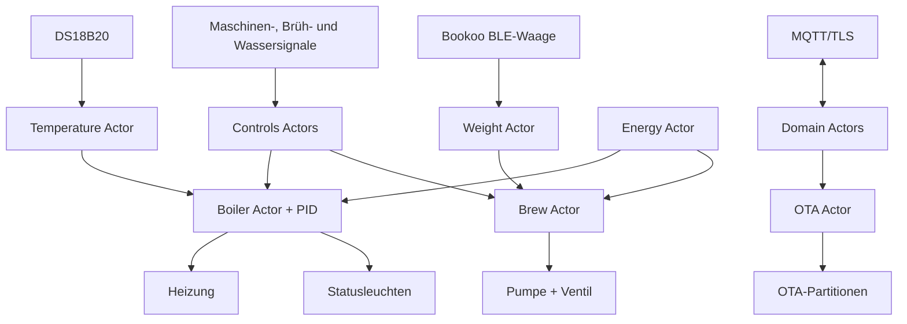

# Esperra

`Esperra` ist eine in Rust geschriebene `no_std`-Firmware für die Steuerung einer Espressomaschine mit einem ESP32-S3. Sie verbindet Temperaturregelung, Brühsteuerung, Wasserstandserkennung, eine Bluetooth-Waage, MQTT-Telemetrie und sichere OTA-Updates in einer asynchronen Actor-Architektur.

> [!WARNING]
> Espressomaschinen arbeiten mit Netzspannung, hohen Strömen, Druck und heißem Wasser. Die Firmware ersetzt keine geeigneten Schutzschaltungen, Sicherungen, Thermostate oder eine fachgerechte elektrische Installation. Arbeiten an netzspannungsführenden Komponenten dürfen nur von qualifizierten Personen durchgeführt werden.

## Funktionsumfang

- PID-basierte Kesselregelung mit Vollheizphase unterhalb des konfigurierbaren Boost-Bereichs
- Temperaturmessung über einen DS18B20 mit Plausibilitäts- und Aktualitätsprüfung
- Ansteuerung von Heizung, Pumpe, Ventil sowie Betriebs- und Statusleuchte
- Auswertung von Maschinen-, Brüh- und Wasserstandssignalen
- Automatischer Brühstopp anhand einer Bookoo-Waage über Bluetooth LE
- Energiesparmodus nach einer Stunde ohne Aktivität
- Persistente Laufzeitkonfiguration im Flash
- MQTT 5 über TLS für Steuerung und Telemetrie
- HTTPS-OTA mit semantischem Versionsvergleich und Bootloader-Rollback
- GitLab-CI-Pipeline für Bootloader, Recovery-Image, OTA-Image und Releases

## Zielhardware

Die Firmware ist fest für einen **ESP32-S3 mit mindestens 8 MB Flash** konfiguriert. Das Build-Target lautet `xtensa-esp32s3-none-elf`.

| Funktion | GPIO | Richtung | Aktivpegel |
| --- | ---: | --- | --- |
| DS18B20 / OneWire | 15 | Ein-/Ausgang | Open Drain |
| Wasserstand | 16 | Eingang mit Pull-up | Low |
| Brühstatus | 17 | Eingang mit Pull-up | Low |
| Maschinenstatus | 18 | Eingang mit Pull-up | Low |
| Heizung | 21 | Ausgang | High |
| Debug-LED-Kanal | 38 | Ausgang / RMT | hardwareabhängig |
| Statusleuchte | 42 | Ausgang | Low |
| Betriebsleuchte | 39 | Ausgang | Low |
| Pumpe | 41 | Ausgang | Low |
| Ventil | 40 | Ausgang | Low |
| Debug-LED-Kanal | 48 | Ausgang / RMT | hardwareabhängig |

GPIO 19 und GPIO 20 bleiben frei, damit natives USB Serial/JTAG des ESP32-S3 verfügbar bleibt.

## Systemübersicht



Die Anwendung trennt Verantwortlichkeiten in drei Bereiche:

- `src/domain` enthält Aktoren, Nachrichten, Zustandslogik und schmale Port-Traits.
- `src/adapter` bindet Flash, GPIO, OneWire, MQTT-Logging, OTA und die Bookoo-Waage an die Domain an.
- `src/library` stellt die Actor-Laufzeit sowie Bluetooth-, Netzwerk-, Messaging- und Debug-Infrastruktur bereit.

`src/main.rs` ist der Composition Root. Dort werden alle Adapter und Aktoren erzeugt, miteinander verbunden und in Embassy ausgeführt. Die schnellen Regel- und Eingangsschleifen laufen alle 100 ms, die langsameren Mess-, Telemetrie- und Wartungsaufgaben jede Sekunde.

## Voraussetzungen

- ESP32-S3 mit mindestens 8 MB Flash
- Rust ab Version 1.91 laut `Cargo.toml`
- Espressifs Xtensa-Toolchain, installiert über [`espup`](https://github.com/esp-rs/espup)
- [`espflash`](https://github.com/esp-rs/espflash) zum lokalen Flashen
- Optional: ESP-IDF 5.5.x zum lokalen Erzeugen des Rollback-Bootloaders

Der ESP32-S3 verwendet Xtensa und kann deshalb nicht mit der regulären Rust-Toolchain für RISC-V-Mikrocontroller gebaut werden.

## Entwicklungsumgebung einrichten

```bash
cargo install espup
espup install
. "$HOME/export-esp.sh"
cargo install espflash
```

Die Datei `.cargo/config.toml` wählt automatisch das richtige Target, baut `core` und `alloc` für dieses Target und richtet `espflash` als Runner ein.

## Firmware konfigurieren

Standardwerte werden zur Compile-Zeit über Umgebungsvariablen gesetzt. Beim ersten Start legt die Firmware daraus einen persistenten Datensatz in der `config`-Partition an.

| Variable | Standardwert | Bedeutung |
| --- | --- | --- |
| `ESPERRA_WIFI_SSID` | leer | WLAN-SSID |
| `ESPERRA_WIFI_PASSWORD` | leer | WLAN-Passwort |
| `ESPERRA_NTP_SERVER` | `pool.ntp.org` | Server für die Zeitsynchronisation |
| `ESPERRA_MQTT_HOSTNAME` | `mqtt.rohenkohl.dev` | MQTT-Broker |
| `ESPERRA_MQTT_PORT` | `8883` | MQTT-TLS-Port |
| `ESPERRA_MQTT_USERNAME` | `esperra` | MQTT-Benutzername |
| `ESPERRA_MQTT_PASSWORD` | leer | MQTT-Passwort |
| `ESPERRA_MQTT_CLIENT_ID` | zufällig | Client-ID; ohne Vorgabe wird `esperra-<zufall>` verwendet |
| `ESPERRA_MQTT_TOPIC_PREFIX` | `esperra` | Präfix aller MQTT-Topics |
| `ESPERRA_FIRMWARE_URL` | GitLab Package Registry des Projekts | Basis-URL für OTA-Images |
| `ESPERRA_HEATER_OPTIONS_HEATING_CYCLE_MS` | `2000` | Länge eines PID-Schaltzyklus in Millisekunden |
| `ESPERRA_HEATER_OPTIONS_TARGET_TEMPERATURE_INTERVAL` | `0.5` | Toleranzbereich der Statusanzeige in °C |
| `ESPERRA_HEATER_OPTIONS_BOOST_INTERVAL_SIZE` | `5.0` | Abstand zum Sollwert für dauerhaftes Heizen in °C |
| `ESPERRA_HEATER_OPTIONS_TARGET_TEMPERATURE` | `94.0` | Solltemperatur in °C |
| `ESPERRA_PID_GAINS_K_PROPORTIONAL` | `0.1` | Proportionalanteil des PID-Reglers |
| `ESPERRA_PID_GAINS_K_INTERGRAL` | `0.2` | Integralanteil des PID-Reglers; Schreibweise entspricht dem Code |
| `ESPERRA_PID_GAINS_K_DERIVATIVE` | `0.3` | Differentialanteil des PID-Reglers |
| `ESPERRA_WEIGHT_OPTIONS_DOUBLE_SHOT_WEIGHT` | `50.0` | Zielgewicht eines Doppelshots in Gramm |

Beispiel:

```bash
export ESPERRA_WIFI_SSID='mein-wlan'
export ESPERRA_WIFI_PASSWORD='geheim'
export ESPERRA_MQTT_HOSTNAME='mqtt.example.com'
export ESPERRA_MQTT_USERNAME='esperra'
export ESPERRA_MQTT_PASSWORD='geheim'
export ESPERRA_MQTT_TOPIC_PREFIX='kueche/esperra'

cargo build --release
```

> [!IMPORTANT]
> Diese Werte greifen nur, wenn noch kein gültiger Konfigurationsdatensatz im Flash vorhanden ist. Spätere Builds überschreiben die gespeicherte Konfiguration nicht. Änderungen können über MQTT geschrieben oder durch Löschen der Konfigurationspartition erzwungen werden. Zugangsdaten werden in die Firmware kompiliert und unverschlüsselt in der Flash-Konfiguration gespeichert.

## Bauen und flashen

### Build prüfen

```bash
cargo build --release
```

Das Binary liegt anschließend unter:

```text
target/xtensa-esp32s3-none-elf/release/esperra
```

### Direkt aus der Entwicklungsumgebung flashen

Wenn das USB-Gerät in der Entwicklungsumgebung erreichbar ist:

```bash
cargo run --release
```

Der konfigurierte Runner flasht die Anwendung mit 8-MB-Layout und öffnet anschließend den seriellen Monitor.

### Erstinstallation oder Wiederherstellung

Für ein neues Gerät wird das zusammengeführte `firmware.bin` aus dem GitLab-CI-Job `build:firmware` empfohlen. Es enthält Bootloader, Partitionstabelle und Factory-Anwendung.

```bash
espflash flash --format raw firmware.bin /dev/tty.usbmodemXXXX
```

Alternativ mit `esptool`:

```bash
esptool.py --chip esp32s3 write_flash 0x0 firmware.bin
```

Das kleinere `firmware-ota.bin` ist ausschließlich für die OTA-Anwendungspartitionen vorgesehen und kein vollständiges Recovery-Image.

## MQTT-Schnittstelle

Die Firmware verbindet sich per MQTT 5 über TLS. Vor dem TLS-Handshake wird die Echtzeituhr über SNTP synchronisiert. Als Trust Anchor dient `res/isrg-root-x1.pem`.

Bei einem Topic-Präfix `esperra` werden folgende Kommandokanäle abonniert:

| Topic | Nachrichtentyp | Beispiel |
| --- | --- | --- |
| `esperra/in/boiler` | `BoilerMessage` | `{"SetActive":true}` |
| `esperra/in/brew` | `BrewMessage` | `{"SetBrewing":true}` |
| `esperra/in/update` | `UpdateMessage` | `"Start"` |
| `esperra/in/config` | `ConfigMessage` | `{"UpdateTemperatureOptions":{"target_temperature":93.0}}` |
| `esperra/in/energy` | `EnergyMessage` | `{"SetActive":true}` |
| `esperra/in/weight` | `WeightMessage` | `"MonitorWeight"` |

Beispiel mit `mosquitto_pub`:

```bash
mosquitto_pub \
  --host mqtt.example.com \
  --port 8883 \
  --username esperra \
  --pw geheim \
  --topic esperra/in/config \
  --message '{"UpdatePidGains":{"k_proportional":0.8,"k_integral":0.15,"k_derivative":0.05}}'
```

Telemetrie wird als JSON unter `<präfix>/out/<aktor>` veröffentlicht. Relevante Topics sind unter anderem:

- `.../out/temperature` und `.../out/weight`
- `.../out/water` und `.../out/energy`

- `.../out/config/heater_options`
- `.../out/config/temperature_options`
- `.../out/config/pid_gains`
- `.../out/config/firmware_info`
- `.../out/config/network_info`
- `.../out/config/weight_options`

Die Enum-Payloads verwenden Serdes standardmäßige extern getaggte JSON-Darstellung. Nachrichten werden fire-and-forget in begrenzte Actor-Mailboxen eingestellt; bei einer vollen Mailbox kann eine Nachricht verworfen werden.

## Regelung und Schutzverhalten

- Die Heizung bleibt aus, solange kein gültiger Temperaturwert vorliegt.
- Gültige Messwerte müssen endlich, zwischen 2 °C und unter 125 °C sowie höchstens fünf Sekunden alt sein.
- Unterhalb von `Solltemperatur - Boost-Bereich` heizt die Firmware durchgehend; darüber wird die Leistung per PID auf den Heizzyklus abgebildet.
- Bei zu niedrigem Wasserstand werden Kessel und Brühgruppe gesperrt, Heizung und Bezug abgeschaltet und die Betriebsleuchte blinkt.
- Nach einer Stunde ohne Aktivität werden Heizung, Bezug und Leuchten deaktiviert.
- Sobald die Bookoo-Waage ihren Ready-Zustand meldet, stoppt die Firmware den Bezug zwei Gramm vor dem konfigurierten Zielgewicht.

Diese Softwaremechanismen sind zusätzliche Betriebslogik und keine funktional sicheren Schutzfunktionen.

## OTA-Updates und Rollback

Ein Update kann über `"Start"` auf `<präfix>/in/update` oder über die Wartungsgeste ausgelöst werden: Maschine für **8 bis 12 Sekunden** ausschalten und wieder einschalten.

Der Ablauf:

1. Eingänge, Temperaturmessung, Kessel, Brühgruppe und Leuchten werden exklusiv für den Update-Aktor gesperrt.
2. Heizung, Pumpe und Ventil werden abgeschaltet; anschließend wartet die Firmware zwei Sekunden.
3. Ein bereits gestartetes OTA-Image wird als gültig bestätigt, oder die Firmware lädt `<firmware-url>/latest/firmware-ota.bin` per HTTPS.
4. Die Version aus dem ESP-App-Descriptor wird als `major.minor.patch` mit der gespeicherten Version verglichen.
5. Ein neueres Image wird in die inaktive OTA-Partition geschrieben, aktiviert und per Software-Reset gestartet.
6. Bis zur Bestätigung durch die nächste Wartungsgeste kann der rollback-fähige Bootloader auf das vorherige Image zurückkehren.

Während des Downloads blinken beide Leuchten im Abstand von 500 ms. Die Partitionierung in `res/partitions.csv` reserviert eine Factory- und zwei OTA-Partitionen mit jeweils `0x1a0000` Byte.

## GitLab CI und Releases

Die Pipeline in `.gitlab-ci.yml` führt drei Stufen aus:

1. `build:bootloader` erstellt mit ESP-IDF 5.5.2 einen Bootloader mit aktiviertem App-Rollback.
2. `build:firmware` baut die Release-Firmware und erzeugt `firmware.bin` sowie `firmware-ota.bin`.
3. `release:firmware` veröffentlicht bei Tags im Format `vMAJOR.MINOR.PATCH` das OTA-Image in der Generic Package Registry.

Vor einem Release müssen Paketversion und Tag übereinstimmen:

```bash
# Cargo.toml: version = "1.2.0"
git tag v1.2.0
git push origin v1.2.0
```

Der Release-Job veröffentlicht die versionierte Datei und ersetzt zusätzlich `latest/firmware-ota.bin`. In GitLab sollten WLAN-, MQTT- und sonstige Zugangsdaten als geschützte CI/CD-Variablen gepflegt werden.

## Projektstruktur

```text
.
├── .cargo/config.toml       # Xtensa-Target, rustflags und espflash-Runner
├── boot/                    # ESP-IDF-Projekt für den Rollback-Bootloader
├── res/
│   ├── isrg-root-x1.pem     # Root-CA für MQTT und OTA
│   └── partitions.csv       # Config-, Factory- und OTA-Partitionen
├── src/
│   ├── adapter/             # Hardware- und Infrastrukturadapter
│   ├── domain/              # Aktoren, Protokolle und Ports
│   ├── library/             # Actor-, BLE-, Netzwerk- und MQTT-Bausteine
│   └── main.rs              # Hardwareaufbau und Actor-Verdrahtung
├── .gitlab-ci.yml           # Build- und Release-Pipeline
└── Cargo.toml
```

## Entwicklungskonventionen

- Domänenlogik hängt nur von schmalen `*Port`-Traits ab; Hardwaredetails bleiben in `src/adapter`.
- Aktoren besitzen ihren Zustand und verarbeiten immer genau eine Nachricht gleichzeitig.
- Publizierte Ereignisse werden über typisierte `Subscriber<T>` verteilt.
- Mailboxgrößen sind bewusst Teil des Verhaltens und werden in `src/main.rs` festgelegt.
- Für Ports wird statische, generische Dependency Injection gegenüber `dyn Port` bevorzugt, sofern kein gemeinsam genutztes Trait-Objekt erforderlich ist.
- Formatierung erfolgt mit der projektspezifischen `rustfmt.toml`.

```bash
cargo fmt --all -- --check
cargo build --release
```
